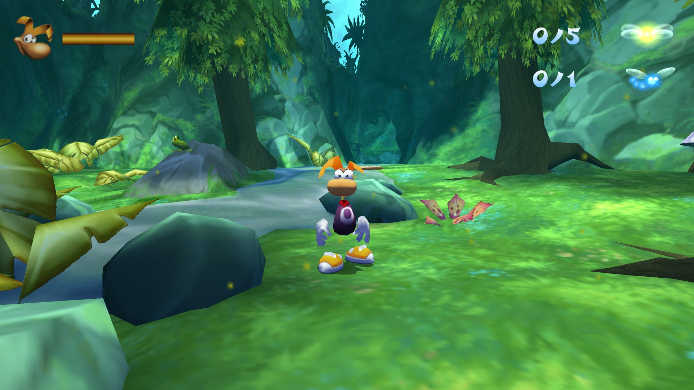

# Rayman Re-Revolution, a native PC port of Rayman 2 Revolution (PS2)


This is **Rayman Re-Revolution: a native PC port of Rayman Revolution based on the PS2 decompilation on my profile**: https://github.com/got4n/rayman-revolution-decomp
(disclaimer like on the decomp's repo: code is still very messy, I plan on cleaning it, so I'm sorry for that)  


<ins> **This is NOT a recompilation** </ins>, this is a native PC port based on a 100% matching decompilation.
The decompilation is 100% complete and this native port is **playable from start to finish**! Right now, the port compiles for Windows, macOS, Linux but only Windows/Mac builds have been tested.

<p align="center"><a href="docs/screenshot.jpg"></a></p>

This is the game's code compiled to PC:
- the calls to Sony's libraries go through a small PC layer
- the graphics driver (GLI/GLD) is replaced by a Vulkan driver
- the sound driver (`UBISOUND.IRX`) is compiled from its own decompilation and running natively as well.
- the game's BF files are extracted and the game runs from there.

This repository contains no game data. You'll need your own copy of the game.
Only the US version (SLUS-20138) is supported, PAL won't work.
Check down here for the known issues.

Rayman is a trademark of Ubisoft. This project is neither affiliated with nor endorsed by Ubisoft, and contains no game data.

## What this port adds compared to regular Rayman Revolution
Some quality of life features were added and are togglable:
Everything is set in the in-game menu (F1, or L3 + R3 on a controller).

| Tab      | Options |
| -------- | ------- |
| Graphics | -Upscaled resolution (4K, 8K etc)<br>-60fps and 120fps (interpolation)<br>-widescreen (16:9; 16:10, 21:9) <br>-filters (CRT, composite, sharpen, FXAA, vivid colours)<br>-texture filtering (trilinear/anisotropic)<br>-increased draw distance (x1 to x4, I suggest putting x2 because it can "break" above)<br>-windowed / full screen<br>-FOV<br>-HUD at the sides and no black bars (for widescreen)<br>-scaling filter (sharp, SSAA, bicubic)<br>-FPS counter<br> |
| Gameplay | -Diagonal speed fix: a fix to the infamous bug where Rayman moves faster when moving diagonally (please toggle that one, I can't insist on how much better the game plays like this)<br>-right stick camera support (experimental, does break at some point, because Revolution only supported left/right camera controls with L1/R1)<br>-fast-forwarding cutscenes/dialogs (by holding Triangle/Y)<br>-autosaving, no more "would you like to save the game" prompts at each transition<br>-Switch, Xbox, Steam Deck, keyboard button prompts<br>-instant loading times<br>-invert X/Y and speed for the right stick camera<br>-vibration (experimental) |
| Controls | -Rebinding of every action (two keyboard keys per action) and of the controller's buttons<br> |
| System   | -Master volume<br>-Discord Rich Presence support<br>-Choice of the saves folder (including a portable mode)<br>-pause when the game is in the background or when the menu is open<br>-update check at start<br>-choosing another copy of the game |
| Extras   | -Speedrun timer (run time and level time)<br>-Cheats (experimental) : Rayman's speed (x2 or x3), infinite health, noclip<br>-a button to reset the timer |
---

# Does it use AI?

Retelling what is said on the decompilation repository:
Unfortunately in some parts, yes. (and I hate AI as much as most people do, also fuck you Sam Altman, fuck you Dario Amodei, fuck all the AIbros).

But... what makes it different compared to AI slop decomps/ports is that you can trust me and my love for the Rayman series on the fact that I have worked with these games enough to at least have an idea on what I'm doing in regards to how this game works internally to at least not try to slop anything.

I'm doing my best to re-read everything that is AI, fix it or make it look cleaner on my own, improve the names and fix as much as I can! Like I said, code is still VERY ugly at that point, but I'm focusing on getting the matching first and I'll try to clean up & label the code more afterwards.

Function matching avoided it as much as possible, but I'm alone on this and also not good enough with programming to code some tools in regards to some stuff like objdiff, compilation etc. If any human would like to improve or rewrite tools, functions; go ahead, I'll gladly take this over any AI code.

I know that some of you might say "if you're not good enough at it, then don't do it in the first place?", to which I answer: yeah sure, but I thought it'd be cool to use my knowledge of the engine/game to at least try to propose something to others, and if I can make others happy with this project, it would already be enough for me!

## Playing

(Requires Vulkan 1.1)

1. Unzip the release (`RaymanRe-Revolution-<version>-windows-x64.zip`) anywhere.
2. Run `revolution.exe` or the Linux/macOS equivalent of that.
3. At the first start the game asks for your copy of the disc. Choose its `.iso` image, or the file
   `SLUS_201.38` on the disc or in a folder with the disc's files. The port checks that it is the
   supported version (SHA-1: `33618569b7a1aa23300e9d1139510220189b3abe`).
4. The program then writes `revolution-full(.exe)` in the same folder. That copy is the one started from then on, and you won't need SLUS after that to run the game.
5. To pick another copy of the game later, run `revolution.exe --choose-game`.

The path can also be given directly: `revolution.exe <.iso image or folder>`

At the first start, the game's BF files are extracted into `GAME` and `SOUND` folders (next to the program on Windows, in the saves folder on macOS/Linux).
Keep your `.iso` where it is though, the game still reads the rest from it, and if you move it, it'll ask for it again.
And don't share `revolution-full`, it contains a part of the game! (hence why it's NOT redistributed there.)

The game starts in your system's language if it's one of the game's five (English, French, German, Italian, Spanish), otherwise in English.

On macOS/Linux the release is only the program at the moment, so you need SDL2, FFmpeg and Vulkan installed:

```sh
brew install sdl2 ffmpeg molten-vk                                   # macOS
sudo apt install libsdl2-2.0-0 libavcodec60 libavutil58 libvulkan1   # Linux (Ubuntu 24.04)
```

---

## Updates

The game checks GitHub for a new release at start (you can turn it off in the System tab, or with `REVO_UPDATE=off`). On Windows it can download and install it by itself from F1 > System, on macOS/Linux it just opens the Releases page at the moment.

---

## Controls and shortcuts

### Shortcuts

| Key | Action |
|---|---|
| F1 (or Cmd+, on macOS) / L3 + R3 | Open / close the menu |
| Guide or the touchpad (controller) | Open / close the menu |
| Q / E, Page Up / Page Down, LB / RB | Previous / next tab in the menu |
| F2 | FPS counter |
| F3 / L1 + R1 + L2 + R2 | Noclip on / off |
| F11 or Alt + Enter | Full screen |
| F12 | Screenshot (in the `screenshots` folder) |
| Esc | Quit the game (no confirmation, so save before!) |

### Default bindings

| PS2 button | Keyboard | Controller (SDL) |
|---|---|---|
| Cross | K or Space | A / Cross |
| Square | J | X / Square |
| Triangle | I | Y / Triangle |
| Circle | L | B / Circle |
| L1 / R1 | A / D | Left / right shoulder |
| L2 / R2 | Q / E | Left / right trigger |
| L3 / R3 | none | Left / right stick click |
| Start / Select | Enter / Backspace | Start / Back |
| D-pad | Arrow keys | D-pad |
| Skip (held) | I | Y / Triangle |

Everything can be rebound in the Controls tab.

---

## Location

| System | Default folder |
|---|---|
| Windows | `Saved Games\Rayman Revolution` |
| macOS / Linux | `$XDG_DATA_HOME/rayman-revolution`, else `~/.local/share/rayman-revolution` |

This folder contains `settings.ini` (the menu's settings), `game.txt` (where your copy of the game is), `memcard0/`
(the memory card, so the saves) and `screenshots/`.

The folder can be changed in the System tab. The portable mode keeps everything in a
`User` folder next to the program (a `portable.txt` file marks it).

Changing the folder (and the portable mode) is Windows only for now.

---

## How it works

### 4-byte pointers in a 64-bit program

The game's structures, its data and the levels of `GAME.BF` are memory images that hold 32-bit
pointers. So the game's code keeps 4-byte pointers:

- `tools/native/ptr32.py` turns every `*` of a type into `* __ptr32 __uptr`, a clang extension, using
  libclang. With that, pointers stored in memory keep 4 bytes and structures keep their PS2 layout
  (`layouts.py` checks it).
- The program is linked at an address aligned on 4 GB (`0x200000000`), so a 4-byte pointer is an
  offset from the program's base. `tools/native/base32.py` makes every load and store through such a
  pointer use base + offset. On macOS the program starts itself again without ASLR to get that alignment.
- `tools/native/irfix.py` repairs the LLVM IR that the back end cannot emit as is: 32-bit pointers in
  static data, calls through 32-bit pointers, `memcpy`…

### The game's memory at the PS2's addresses

The program holds a zone whose offsets from its base are the PS2's addresses
(`tools/native/zone.py`, `host/native_mem.c`). At start, `host/complete.c` copies the player's
`SLUS_201.38` there, as the console's loader did, so the data and the pointers it holds are right as they
are. Each name of the game's data becomes base + its PS2 address. A call through a pointer goes through
`revo_code`, which finds the native function for a PS2 address.

The program as built holds none of the game. On its first start it writes `revolution-full` next to
itself, with the zone already filled from the player's copy. That copy never reads `SLUS_201.38` again
and is started instead from then on (`REVO_FULL=off` turns this off).

```
decomp/src (the game's C, 230 TUs)
   │  tools/guest_build.py    preprocessed with PC_PORT; hostify turns the inline
   │                          assembly (VU0, FPU, MMI) into C
   ▼
build/guest/host/*.i
   │  tools/native/build_native.py:
   │    ptr32.py → clang (LLVM IR) → zone.py → irfix.py → base32.py → clang (asm) → rva.py
   ▼
build/native/obj/*.o            + tools/native/snd_native.py (the sound driver, the same way)
   │  tools/native/glue_native.py   the glue between the game and the host
   │                                (C runtime, graphics driver, PC layer)
   │  llvm-objcopy --redefine-syms
   ▼
ninja + clang/clang++: host/ + gli/ + platform/ + Dear ImGui + zone + glue
   ▼
build/native/revolution(.exe)
```

### CI

The GitHub CI (`.github/workflows/checks.yml`) runs at each push:
- ps2-code: `tools/check_ps2.py` checks that the PS2 code of `decomp/` and `ubisound/` is the original one once the `PC_PORT` blocks are taken out, and that no game data is committed.
- windows: build with MSYS2 CLANG64 then `tools/package.py`.
- macos: build on macOS 15 (arm64).
- linux: build on Ubuntu 24.04 (x86-64).

---

## Building

### Requirements

This project requires: python3, libclang, clang++, lld, LLVM, ninja, pkg-config, SDL2, ffmpeg, Vulkan and glslang.
The build doesn't need the game.

Windows: MSYS2, CLANG64 environment:

```sh
pacman -S mingw-w64-clang-x86_64-{clang,lld,llvm,ninja,python,pkgconf,sdl2-compat,ffmpeg,vulkan-headers,vulkan-loader,glslang} git
python build.py build
```

MSYS2's clang package holds the libclang bindings, then the DLLs the program needs are copied next to it.

macOS (Apple Silicon): Homebrew.

```sh
brew install llvm ninja sdl2 ffmpeg pkg-config molten-vk glslang unifdef python
"$(brew --prefix)/bin/python3" build.py build
```

(note: it uses Homebrew's Python, the one Homebrew's LLVM has its clang bindings for)

Linux (Ubuntu 24.04, x86-64):

```sh
sudo apt install clang-20 lld-20 llvm-20 python3-clang-20 libclang-20-dev ninja-build pkg-config libsdl2-dev libavcodec-dev libavutil-dev libvulkan-dev glslang-tools unifdef
/usr/bin/python3 build.py build
```

(note: it needs clang 20, the default clang 18 of Ubuntu 24.04 fails on the game's C, and it uses the system's Python, the one `python3-clang-20` is for)

### Commands

```sh
python3 build.py build [--assets <game folder>]   # → build/native/revolution(.exe)
python3 build.py run   [--assets <game folder>]   # runs the game (default: the last build's folder)
```

`--assets` (or `REVO_ASSETS`) is optional. With the game's files, and with the decomp's PS2 build
(its `build/SLUS_201.38.elf` and `asm/data`, put in `decomp/`), the build also runs `tools/check_tables.py`,
which checks the game's tables of functions against the C's types.

### Tools

| Script | What it does |
|---|---|
| `tools/bigfile.py list / unpack / extract` | Lists, unpacks or extracts the files of `GAME.BF` |
| `tools/native/link_plan.py`, `undefined.py` | Who gives each symbol the game's objects need |
| `tools/native/layouts.py` | Checks that every structure keeps its PS2 layout |
| `tools/native/zone.py --add` | Adds the names the PC build needs to `decomp/config/revo.symbol_addrs.txt` |

Build variables: `CC`, `CXX`, `REVO_LLVM`, `REVO_CLANG`, `REVO_NATIVE_TARGET` (`windows`, `mac` or `linux`),
`REVO_NATIVE_OPT`, `REVO_NATIVE_CFLAGS`, `REVO_SDL2_CONFIG`, `REVO_PKG_CONFIG`, `REVO_VULKAN_INCLUDE`,
`REVO_GLSLANG`, `VULKAN_SDK`, `REVO_VERSION`.

### The decomp's PS2 build (optional)

It only serves as a check for above and work on the decompilation itself, and it's in its own repo: [rayman-revolution-decomp](https://github.com/got4n/rayman-revolution-decomp) (`tools/setup_external_tools.py --download` downloads the EE compiler, Slinky and objdiff there).

### Windows packaging

```sh
python tools/package.py [--version 0.2.0]
```

This python script writes:
- a portable zip
- `SHA256SUMS.txt` and `files.txt` (the SHA-256 of every file, for the updater)

They're written to `dist/`, with the licenses of the MSYS2 DLLs.
The script stops on any file of the game, on `build_info.json`, on a path of this machine found in the program, or on any bytes of the game's executable found in it.

The version comes from the git tag (`git tag v0.2.0`) or from `REVO_VERSION`, and `--version` has to be the same as the program's.

## Things I'd like to improve
- The right stick camera may be buggy, and vibration is experimental: it only happens when Rayman gets hit or dies.
- The cheats are kind of broken right now, hopefully this can be fixed soon.
- A draw distance above x2 shows some of the game's hacks.
- There might be more stuff I haven't noticed, tell me!


## Licenses and credits

- The port's code is under the MIT license (`LICENSE`), the decompilation too (`decomp/LICENSE`).
- OpenGOAL for showing how to deal with 32 bit pointers.
- The decompilation's credits:
  - the [Rayman 3 decompilation](https://github.com/LawlessCowboy/ray3) project for helping with matching some stuff quicker.
  - the creators of all the amazing (human-made!) tools/resources used here:
  [splat](https://github.com/ethteck/splat),
  [spimdisasm](https://github.com/Decompollaborate/spimdisasm),
  [rabbitizer](https://github.com/Decompollaborate/rabbitizer),
  [Slinky](https://github.com/decompals/slinky),
  [objdiff](https://github.com/encounter/objdiff),
  [decomp.me compilers](https://github.com/decompme/compilers),
  [decomp-permuter](https://github.com/simonlindholm/decomp-permuter),
  [Ninja](https://github.com/ninja-build/ninja)

 - the [PCSX2](https://github.com/PCSX2/pcsx2) developers for helping a lot with the debugger.
- Dear ImGui for the in-game settings menu.
- The Windows release ships MSYS2's DLLs. FFmpeg as MSYS2 builds it is under the GPL version 3 or
  later, so the package as a whole is distributed under its terms.
- The DLLs' licenses are in `THIRD_PARTY_NOTICES.txt` and `licenses/` in the zip.


## Environment variables

| Variable | Effect |
|---|---|
| `REVO_ASSETS` | The game's image or folder (as the first argument) |
| `REVO_SETTINGS` | A settings file to use instead of `settings.ini` |
| `REVO_MEMCARD` | A memory card folder to use |
| `REVO_RESOLUTION` | Internal resolution in % at start |
| `REVO_WINDOW` | Window size, e.g. `1920x1080` |
| `REVO_VSYNC=fifo` | Forces the FIFO present mode (V-Sync) |
| `REVO_MODS` | Just the regular mods (they need to be separated with commas) so: `60fps`, `widescreen`, `interpolation`, `autosave`… |
| `REVO_BF_DIR` | A folder whose files replace `GAME.BF`'s (`off` to turn it off) |
| `REVO_FULL=off` | Does not write or start `revolution-full` |
| `REVO_UPDATE=off` | No update check |
| `REVO_MUTE=1` | No sound |
| `REVO_VULKAN_LIBRARY` | The Vulkan library to load, if it isn't found by itself |

All the mods for `REVO_MODS`: `diagonal`, `right_stick`, `60fps`, `widescreen`, `widescreen_1610`, `interpolation`, `smooth`, `skip_cutscenes`, `skip_dialogues`, `short_loading`, `autosave`. The ones not in the list are off for that run, and `REVO_MODS=off` turns them all off.
